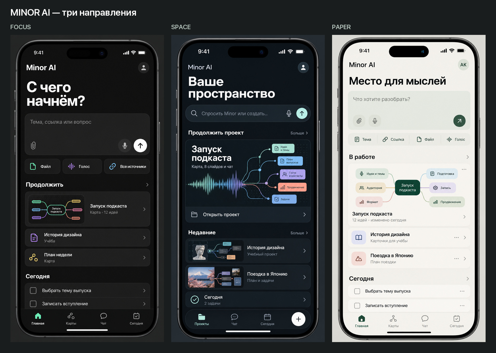
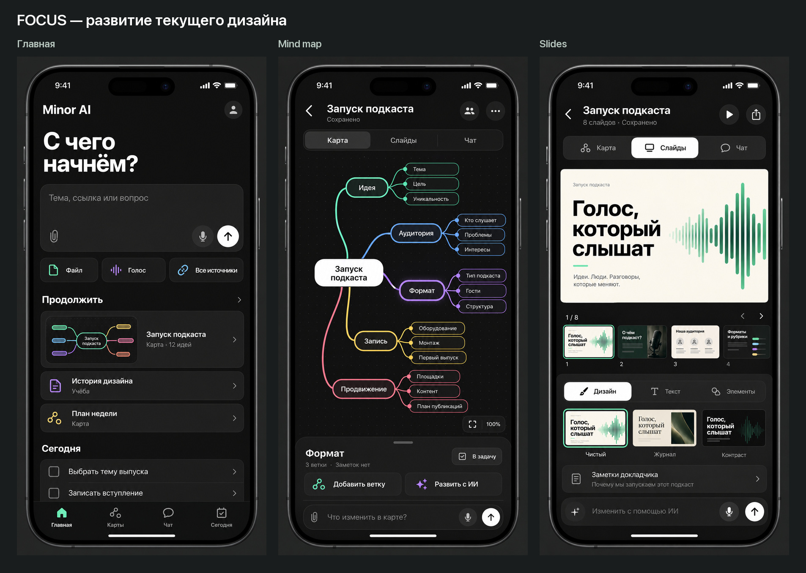
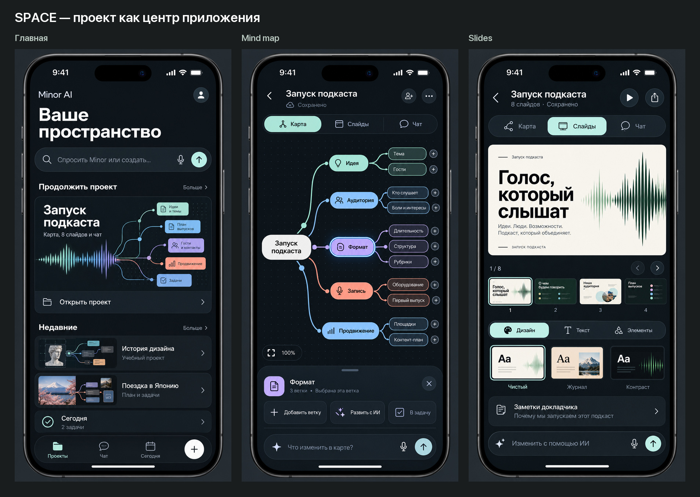
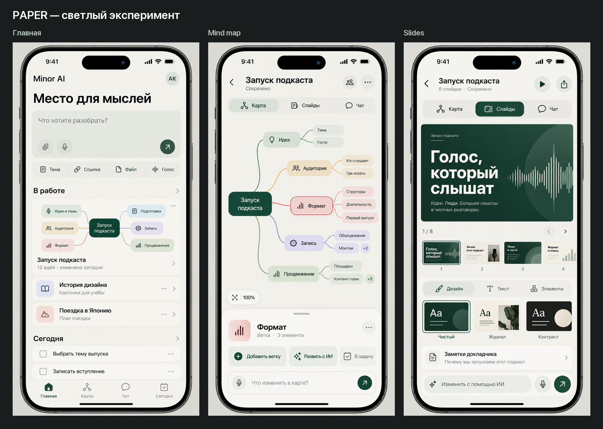
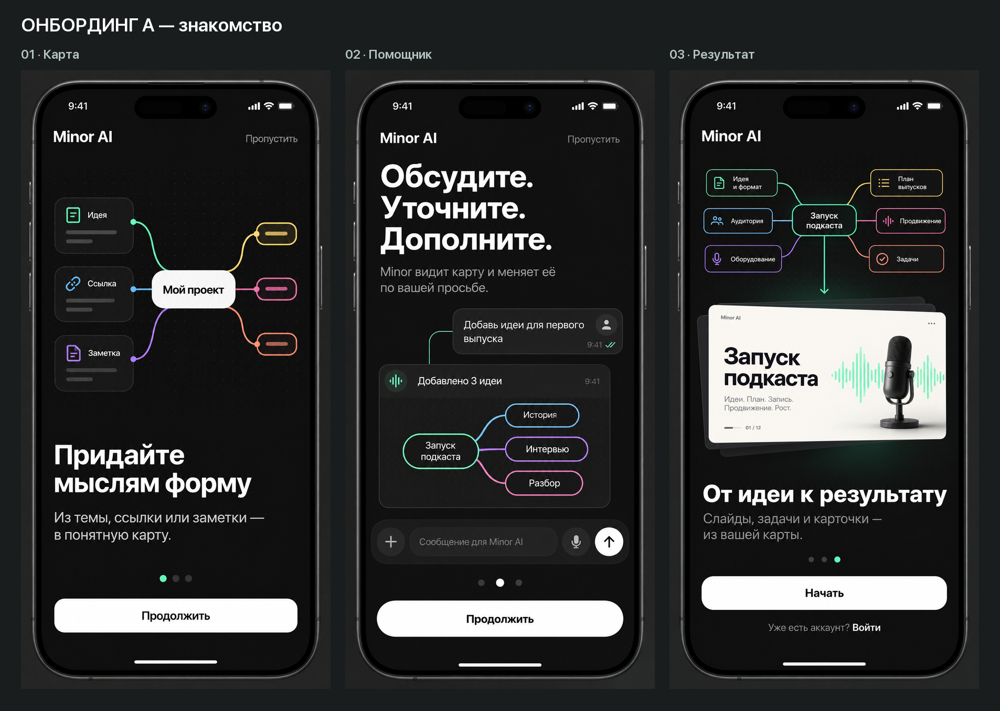
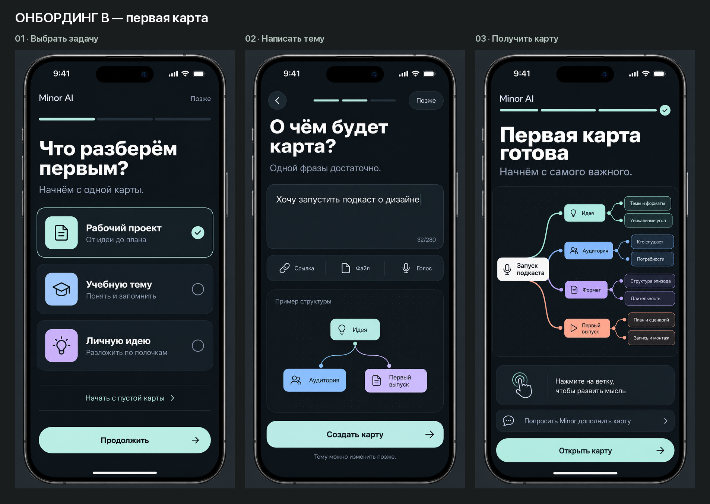

# Minor AI — три направления дизайна

Последнее дополнение: [paywall, приглашения и схемы — 8 экранов](paywall-collaboration-diagrams/README.md), а также [два направления лендинга и оценка текущего сайта](landing-directions/README.md). Варианты paywall и сайта ещё не выбраны пользователем.

**Уточнение после аудита:** нижний вход «Карты» на главной заменяется на «Меню». Полное поведение перехода, связи карты/слайдов/чата и недостающие состояния описаны в [задании Claude Code](../../CLAUDE_CODE_PRODUCT_COMPLETION.md) и [аудите полноты](../../DESIGN_COMPLETENESS_AUDIT.md). Эти документы приоритетнее старых изображений в вопросах поведения.

**Актуальное решение после обратной связи:** сохранить вход через помощника и текущий сплеш, развивать понравившиеся редакторы, за основу онбординга взять вариант A. [Уточнённое направление и два новых экрана](assistant-first/README.md). Рекомендации ниже относятся к первоначальному раунду сравнения.

Следующее продолжение: [разговор с созданием карты, предложения ИИ, экспорт и голосовой режим](assistant-flow/README.md).

Новое продолжение: [10 экранов расширенных редакторов — узлы, метки, темы, виды карты, редактирование слайдов и шаблоны](advanced-editors/README.md). Описаны взаимодействия и границы существующей реализации.

Также подготовлены [создание карты, библиотека и настройки — 5 новых экранов по присланным скриншотам](creation-settings/README.md), включая аккаунт, подписку и доступ к данным.

Новое развитие: [6 экранов продолжения проекта](project-continuity/README.md) — первые и сохранённые слайды, отдельная панель источников без бейджей на узлах, добавление материала, память проекта и следующие действия.

**Отложено пользователем, не реализовывать сейчас:** [сохранённые презентации — открыть, переключить, создать ещё](slides-versions/README.md). Три крупных состояния с общим [обзором](slides-versions/overview.jpg).

12 октября 2026 · 15 самостоятельных экранов · русский интерфейс · концепты для iPhone.

Цель — сравнить изменения в главной странице, карте, презентациях и первом запуске до решения о редизайне. Макеты созданы встроенным image_gen по навыку imagegen-frontend-mobile. Промпты всех 15 экранов сохранены в [prompts.json](prompts.json). Рабочие экраны используют свою главную страницу как референс, чтобы сохранять стиль внутри направления.

Это изображения концептов, а не работающие экраны или спецификация компонентов. Код приложения не менялся. Исходные материалы для сравнения: DesignSystem/DESIGN.md, DesignSystem/tokens.json, сохранённая главная home-classic.png и реальные снимки карты, источников и презентаций в shots/raw/ru. Они отражают сохранённое состояние приложения, а не повторную проверку текущей сборки.

## Быстрое сравнение

| Направление | Что меняется | Сильная сторона | Компромисс |
| --- | --- | --- | --- |
| **Focus** | Быстрый ввод, недавние карты, компактные действия, контекстная панель узла | Сохраняет узнаваемость и упрощает основные действия | На главной ещё стоит уменьшить высоту поля ввода и количество обводок |
| **Space** | Проект объединяет карту, слайды и чат; заметные обложки проектов | Лучше объясняет широту Minor AI и помогает возвращаться к работе | Потребуется уточнить модель проектов и навигацию; крупная обложка вытесняет часть списка |
| **Paper** | Светлый фон, тёмно-зелёный акцент, мягкие цветные ветки | Спокойная среда для чтения и учёбы, хороший контраст с текущим образом | Осознанно выходит за действующий принцип «только тёмная тема»; полноценная тема потребует отдельной проверки контраста |

Моя рекомендация: сохранить тёмную основу и палитру веток, взять компактность редакторов из Focus, связность проекта из Space и проверить онбординг с первой картой. Светлый Paper рассматривать как возможную дополнительную тему. Полезность изменений пока является дизайнерской гипотезой: визуальное сравнение не доказывает рост удобства или конверсии.

## 1. Focus — развитие текущего дизайна

[Главная](focus/01-home.png) · [Mind map](focus/02-mind-map.png) · [Slides](focus/03-slides.png)

Тёмная основа #121212, поверхности #232323, белое главное действие, мятный выбор. На главной видны ввод, продолжение работы и задачи. В карте появляется панель выбранной ветки; в презентациях — миниатюры и варианты оформления непосредственно под слайдом.

## 2. Space — проект как центр приложения

[Главная](space/01-home.png) · [Mind map](space/02-mind-map.png) · [Slides](space/03-slides.png)

Глубокая холодная тёмная основа, светлый мятный акцент, обложки проектов. Общий переключатель «Карта / Слайды / Чат» удерживает пользователя внутри одной темы. Название Space здесь — рабочее имя концепта, не решение переименовать приложение.

## 3. Paper — светлый эксперимент

[Главная](paper/01-home.png) · [Mind map](paper/02-mind-map.png) · [Slides](paper/03-slides.png)

Тёплый светлый холст, лесной зелёный акцент и мягкие ветки. Сохранены структура продукта, связь карты со слайдами и помощником. Это специально альтернативное направление, а не изменение действующих токенов.

## Онбординг A — короткое знакомство

[1. Придайте мыслям форму](onboarding-tour/01.png) → [2. Обсудите и дополните](onboarding-tour/02.png) → [3. От идеи к результату](onboarding-tour/03.png)

Первый экран показывает превращение источников в карту. Второй — редактирование через помощника. Третий — превращение карты в результат. Подойдёт для краткого знакомства перед входом в продукт. Иллюстрации на шагах являются демонстрацией; в прототипе нужно отличить их от настоящих интерактивных полей. Вход доступен на последнем шаге, без обязательного запроса разрешений или рейтинга.

## Онбординг B — первая карта сразу

[1. Выбрать задачу](onboarding-first-map/01.png) → [2. Написать тему](onboarding-first-map/02.png) → [3. Открыть готовую карту](onboarding-first-map/03.png)

Предпочтительный сценарий для проверки: человек получает собственную карту в первом сеансе. Пример темы — «Хочу запустить подкаст о дизайне». После результата — одна подсказка о ветках. Пропуск ведёт к главной, отдельная ссылка позволяет начать с пустого холста. При реализации надо определить гостевой режим, условия генерации, сохранение результата, состояния ожидания, ошибки и последующий вход в аккаунт.

## Что я бы проверил до решения о редизайне

1. Дать человеку создать карту из ссылки, найти недавнюю карту и открыть слайды — сравнить текущий интерфейс и Focus/Space.
2. Проверить карту с 50–100 узлами, длинными названиями и открытой клавиатурой. На концептах показана компактная демонстрационная карта.
3. Проверить редактирование презентации на небольшом iPhone: клавиатура, выбор текста, экспорт и заметки докладчика.
4. Для онбординга сравнить долю пользователей, которые действительно открыли и изменили первую карту, а не только завершили вступительные экраны.

## Границы макетов

Все пятнадцать изображений проверены визуально на состав экранов, читаемость основных надписей и соответствие направлениям. Каждый исходник — 887 × 1774 px. Обзорные листы показывают полные изображения без вырезания экранов; для мелких деталей открывайте отдельные PNG.

Генеративные макеты не задают точные размеры и поведение компонентов. Встречаются вариации радиусов, толщины линий, пунктуации и второстепенных иконок. Счётчики, демонстрационные названия и миниатюры являются наполнением концепта; в частности, счётчик 32/280 в онбординге не задаёт лимит приложения. Соотношение сторон слайдов, Dynamic Type, контраст и зоны нажатия предстоит нормировать в точном макете. Новая версия фирменного знака не создавалась: в этих концептах используется текст Minor AI.

В папке лежат только концепты, обзорные листы, промпты, опись и этот документ. Публикация, изменение приложения и замена App Store материалов не выполнялись.
