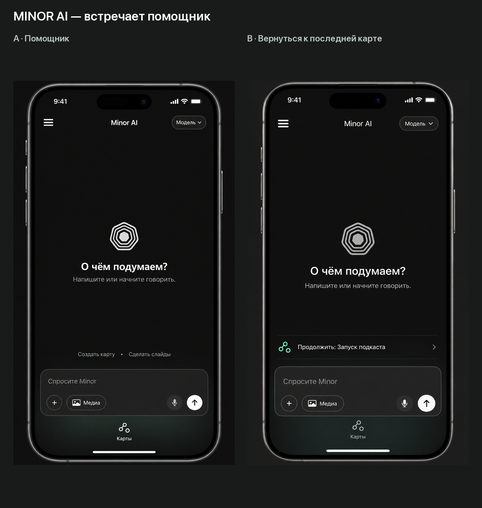
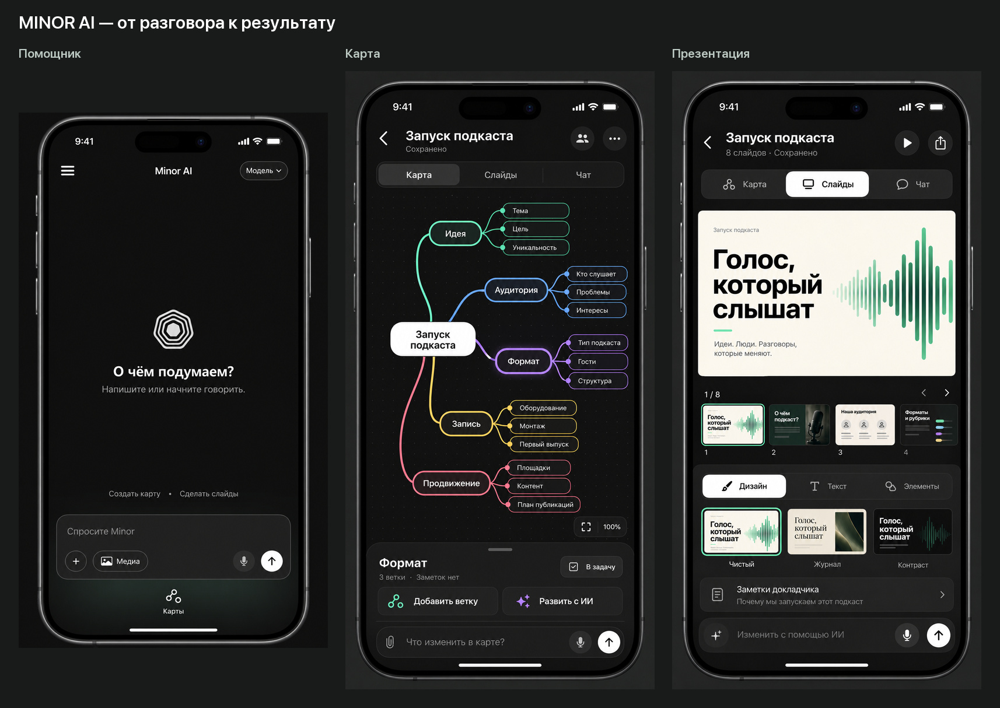

# Minor AI — помощник на первом экране

Уточнение направления после обратной связи пользователя, 12 октября 2026.

## Принятое направление

- Сохранить текущую встречу с помощником после сплеша: свободный тёмный экран, фирменный знак, поле разговора внизу.
- За основу онбординга взять **вариант A — знакомство с возможностями**. Предыдущее предпочтение сценария «первая карта сразу» больше не является рекомендацией для выбранного направления.
- Развивать понравившиеся редакторы mind map и slides. Конкретная тема редакторов пользователем пока не выбрана; в сводном листе использован Focus как наиболее близкая текущему оформлению база.
- Проекты и история доступны из меню и контекста разговора. Они не заменяют помощника при входе.

## Два состояния одного входного экрана

[A. Чистый помощник](01-assistant-pure.png) — предпочтительная основа. Небольшое приглашение к разговору и тихие действия «Создать карту / Сделать слайды». Они должны запускать соответствующее действие, а не вынуждать пользователя угадывать текст команды.

[B. Продолжение работы](02-assistant-resume.png) — возможное состояние для возвращающегося пользователя. Одна строка последней карты над полем ввода, без списка карточек. Показывать только при наличии содержательного недавнего проекта, а не сразу после регистрации. Это предложение, не утверждённое поведение.

## Связь со сплешем

В текущем `Minor Ai/Views/LaunchSplash.swift` знак собирается из колец, затем раскрывает портал и уменьшается к положению знака на главном экране. В `SplashScene.draw` якорь задан как `x = width / 2`, `y = safeTop + height / 2.5`. Этот переход — часть выбранной концепции, его следует сохранить. Новые подписи должны появляться после завершения перехода, чтобы не спорить с анимацией. Точный момент появления требует просмотра движущегося прототипа; в этой задаче сделаны статичные изображения.

## Дальнейшая логика

Обычный вход: существующий сплеш → помощник → разговор или голос → карта / презентация по намерению пользователя.

Внутри проекта: «Карта / Слайды / Чат» сохраняют общий контекст. Возврат к помощнику не должен терять текущую карту. Онбординг A знакомит с этой последовательностью: мысль → помощь Minor → результат. Порядок показа сплеша, существующего первого запуска и авторизации здесь не менялся.

## Материалы

- [Онбординг A](../onboarding-tour/overview.jpg).
- [Карта Focus](../focus/02-mind-map.png).
- [Презентации Focus](../focus/03-slides.png).
- [Промпты двух уточнённых экранов](prompts.json).

Изображения созданы встроенным image_gen с референсами существующей главной, оформления Focus и исходного знака `minor_plus-3.png`. Это концепты, не финальные UI-ассеты. При реализации знак нужно брать из оригинального ассета; изображение из генеративного макета не заменяет исходник. Размеры элементов и позицию знака необходимо точно согласовать с текущим переходом сплеша. Код приложения и анимация не менялись.
# Уточнение навигации от 12 октября 2026

В выбранной главной нижняя кнопка «Карты» заменяется на «Меню» с иконкой сетки. Помощник и сплеш сохраняются. Маршруты, содержимое меню и анимация определены в [задании Claude Code](../../../CLAUDE_CODE_PRODUCT_COMPLETION.md). Изображения ниже остаются референсом общего вида; подпись и назначение нижней кнопки в них устарели.

