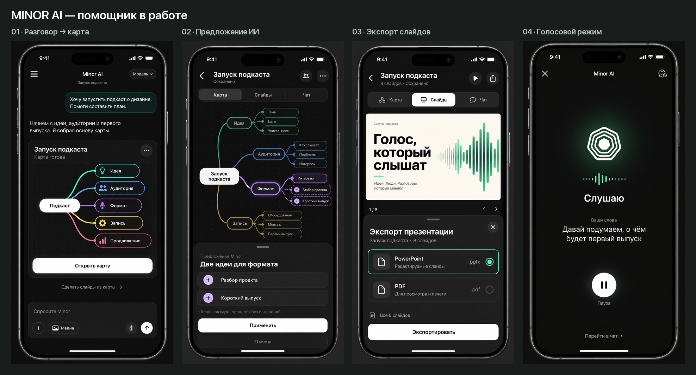

# Minor AI — помощник в работе

Продолжение выбранного направления, 12 октября 2026. Четыре новых изображения созданы встроенным image_gen по навыку imagegen-frontend-mobile. [Полные промпты и пути референсов](prompts.json).

Главный принцип сохраняется: существующий сплеш раскрывает экран помощника; карта и презентация появляются по ходу работы с идеей. За основу первого запуска остаётся выбранный пользователем онбординг A.

## 1. Разговор → карта

[Открыть экран](01-chat-to-map.png).

После запроса о запуске подкаста Minor отвечает текстом и показывает одну карточку готовой карты с настоящим смысловым превью. Основное действие — «Открыть карту». Вторичное — «Сделать слайды из карты». Обычный разговор остаётся доступен в нижнем поле. Большой приветственный знак исчезает при появлении сообщений.

Переход в редактор должен сохранять разговор и привязку к созданной карте. Возврат из редактора возвращает в тот же чат. В маленьком окне или при открытой клавиатуре карточка результата прокручивается вместе с сообщениями; поле ввода остаётся доступным.

## 2. Выбранная ветка → предложение ИИ

[Открыть экран](02-map-ai-preview.png).

Показан предлагаемый новый сценарий: Minor предлагает два дополнения к ветке «Формат». Пунктирные соединения и плюс отличают новые узлы от сохранённых. Небольшая нижняя панель поясняет изменение и даёт «Применить» / «Отмена». Панель временно заменяет командное поле, чтобы не оставлять два конкурирующих действия.

Это предложение для UX, не утверждение о текущей реализации. После применения новые узлы становятся обычными, а панель закрывается; отмена возвращает исходное состояние. Перед реализацией необходимо определить, какие AI-операции требуют такого предпросмотра, чтобы не добавлять лишнее подтверждение к каждому небольшому действию.

## 3. Презентация → экспорт

[Открыть экран](03-slides-export.png).

Пользователь видит текущий слайд за нижней панелью и выбирает PowerPoint или PDF. Подписи объясняют разницу без технических настроек. После «Экспортировать» нужен явный процесс подготовки файла, затем системное меню сохранения/отправки. Ошибка остаётся в этой панели с повтором; документ и выбранный формат сохраняются. На статичном макете показан только выбор формата.

## 4. Помощник → голосовой разговор

[Открыть экран](04-voice-listening.png).

Спокойный голосовой экран продолжает настроение стартового помощника. Фирменный знак остаётся узнаваемым; динамика предлагается в свечении и индикаторе уровня под ним. Расшифровка явно подписана «Ваши слова». «Пауза» останавливает прослушивание; «Перейти в чат» возвращает к тексту с сохранением разговора; крестик завершает голосовой режим.

Показано состояние «Слушаю». В текущем VoiceModeView уже есть состояния listening, thinking, speaking и paused. Для остальных предлагаются подписи «Думаю», «Отвечаю» и «На паузе», с явно различимыми действиями. Конкретное поведение и анимацию потребуется проверить в прототипе. Использование знака вместо нынешней сферы — предложение дизайна, а не выполненная замена.

## Что сохраняется из предыдущего раунда

- [Главный экран помощника A](../assistant-first/01-assistant-pure.png).
- [Базовая карта Focus](../focus/02-mind-map.png).
- [Базовый редактор слайдов Focus](../focus/03-slides.png).
- [Онбординг A](../onboarding-tour/overview.jpg).

История карт и проектов остаётся доступной из меню; она не заменяет помощника при входе. Текущая анимация сплеша и якорь фирменного знака сохраняются как основа направления.

## Проверка и границы

Все четыре исходника открыты и просмотрены: основные подписи читаются, выбранная ветка и предложенные изменения различимы, на голосовом экране обозначено состояние, на экспорте виден выбранный формат. Обзорный лист содержит полные изображения с сохранением пропорций.

Это статичные генеративные концепты. Они не подтверждают работу переходов, точный контраст, 44pt зоны нажатий, Dynamic Type, клавиатуру, экспорт или AI-операции. Фирменный знак при реализации должен браться из исходного ассета, а не из изображения концепта. Действующая сборка, сплеш и App Store материалы не менялись.
