# Просмотр макетов

Каждый PNG — отдельный экран. Это визуальные концепты, не скриншоты реализованного приложения. Точное поведение — в [UX_SPEC.md](UX_SPEC.md).

## Действия с узлом

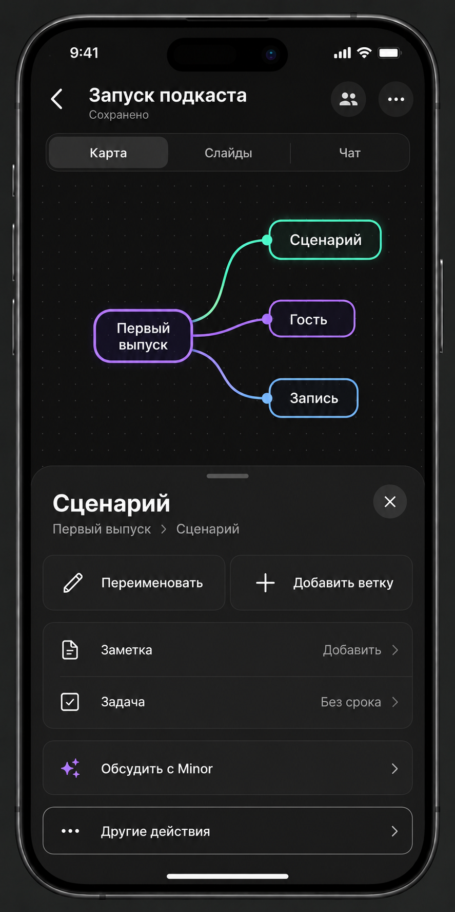

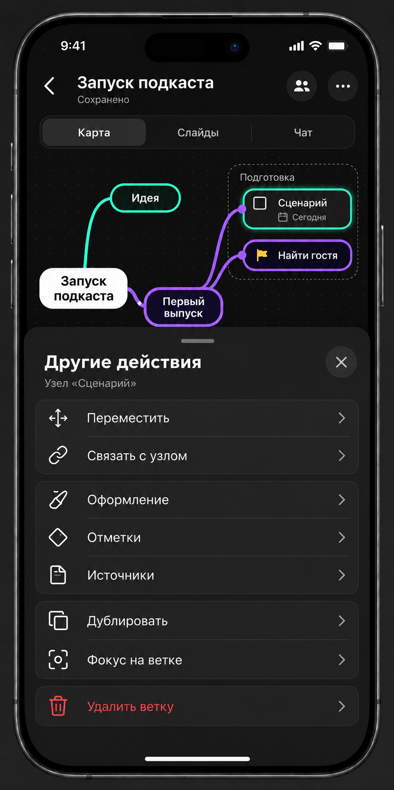

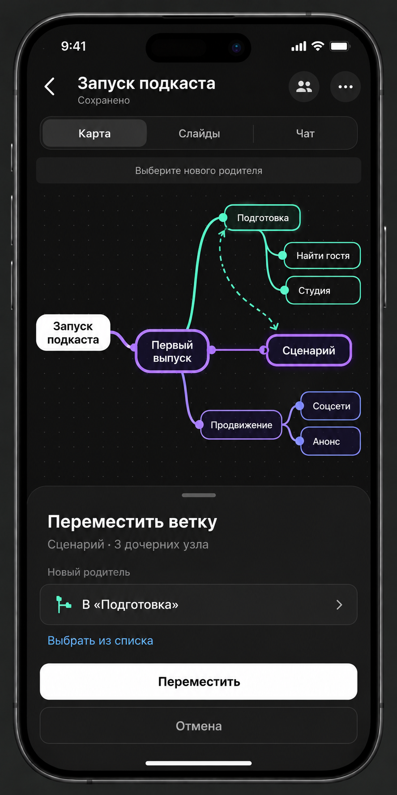

## Сегодня

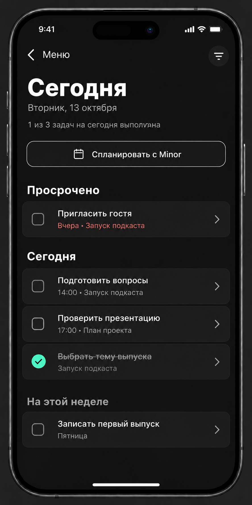

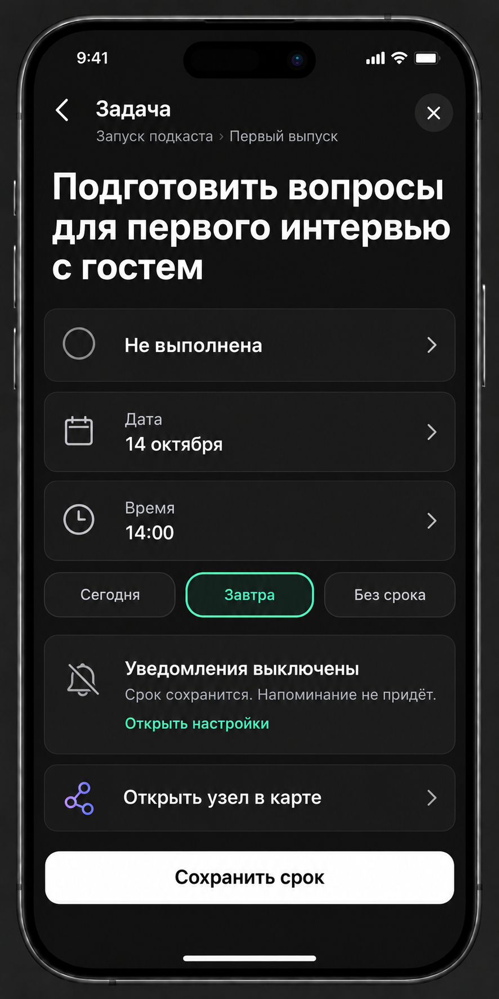

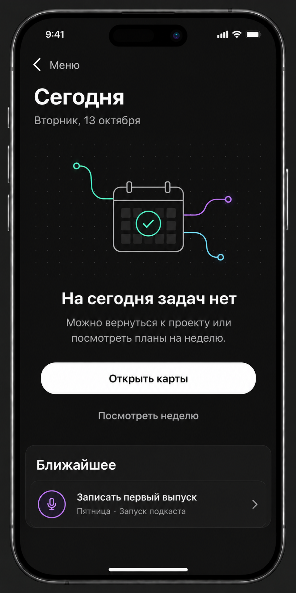

## Учёба

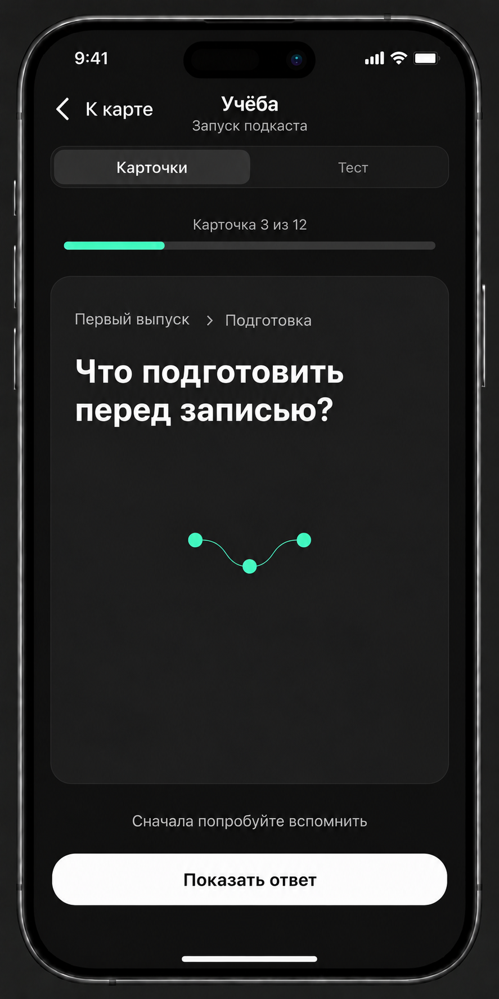

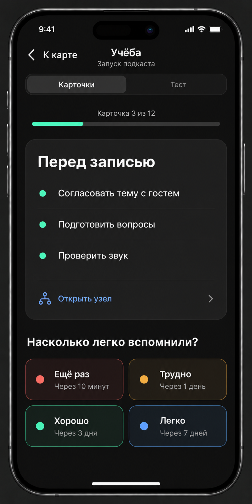

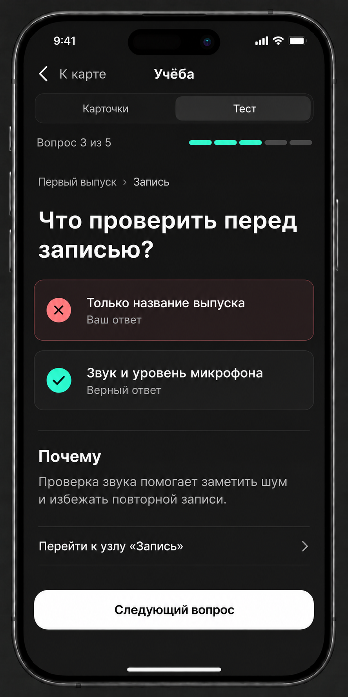

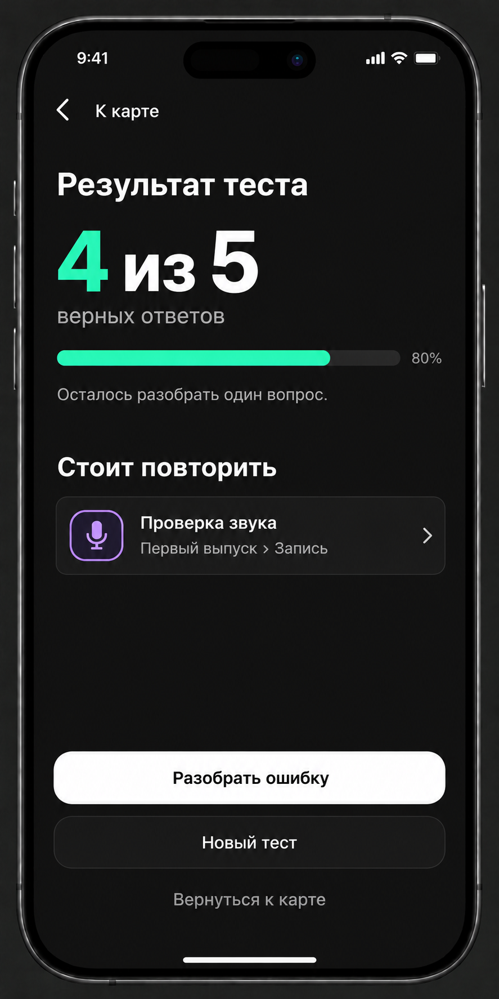

## Показ и экспорт

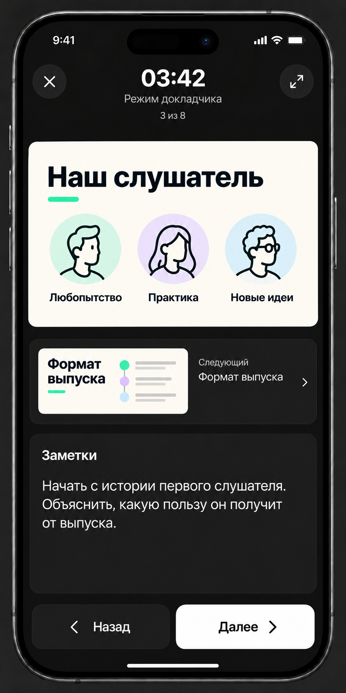

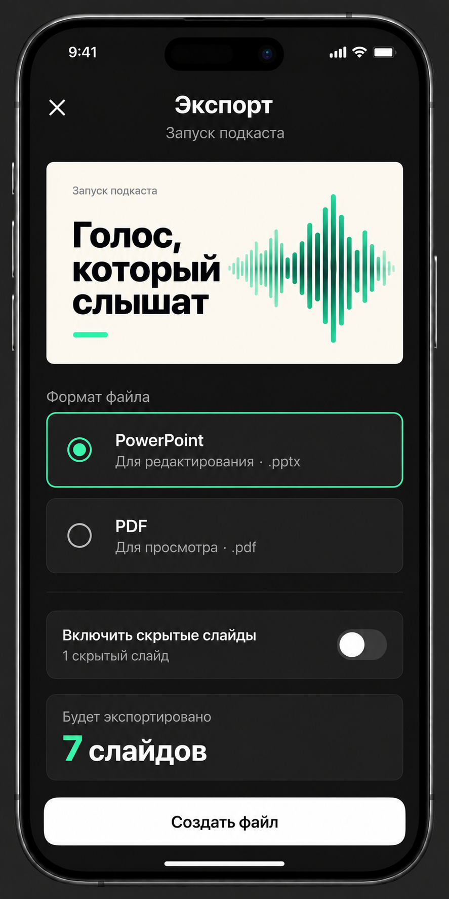

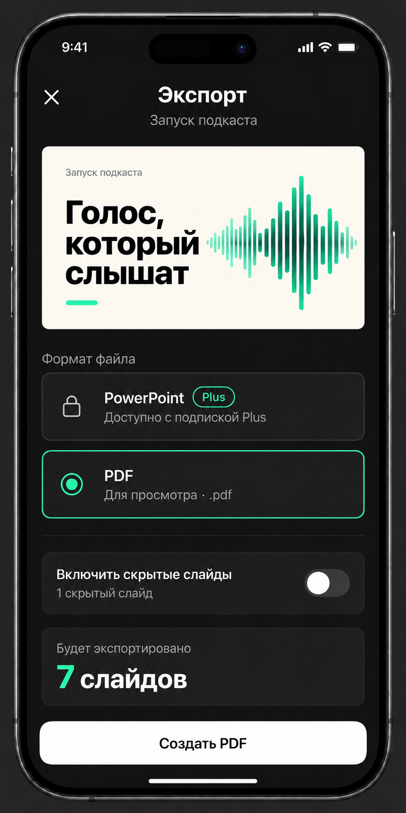

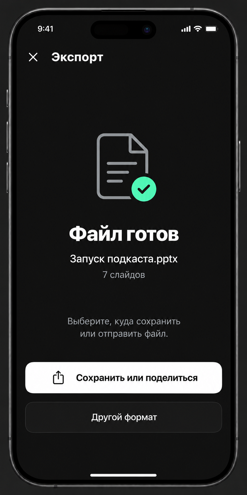

## Общие состояния

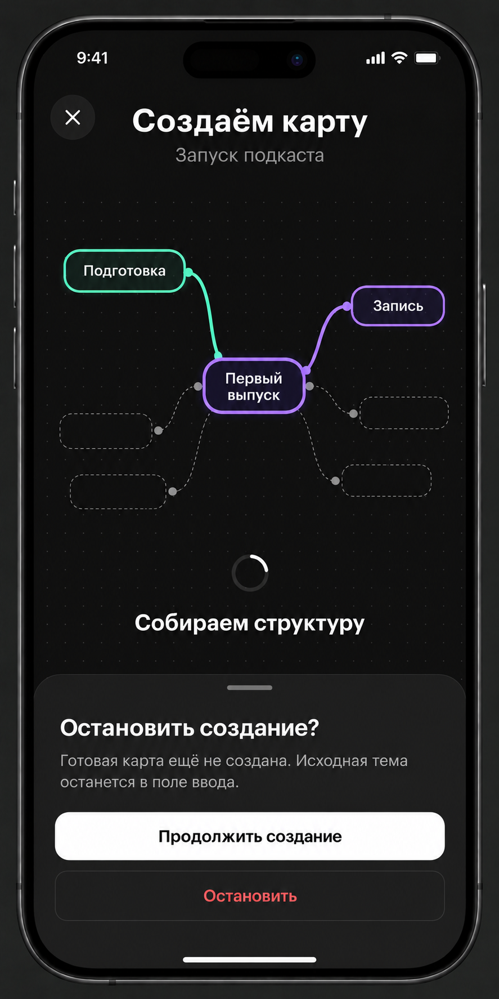

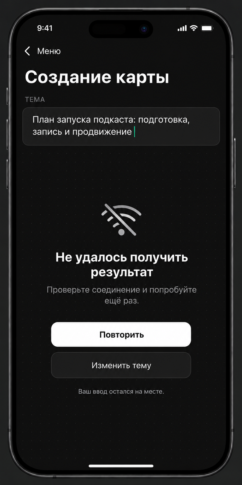
